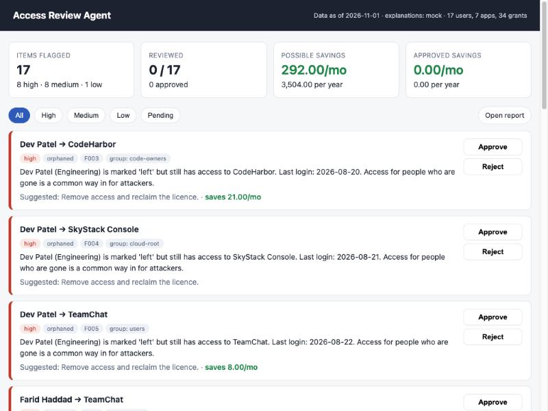
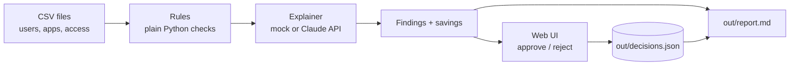
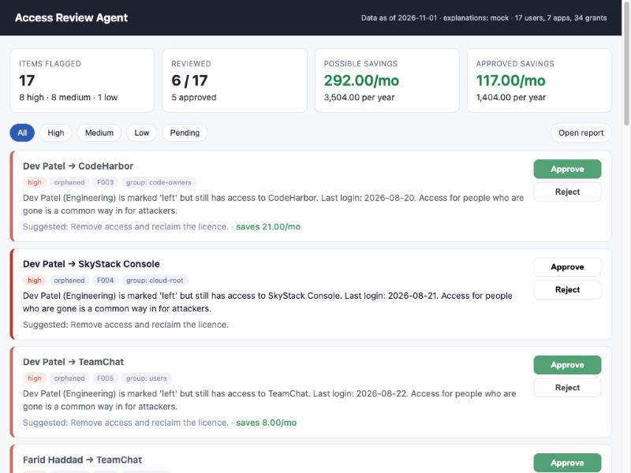
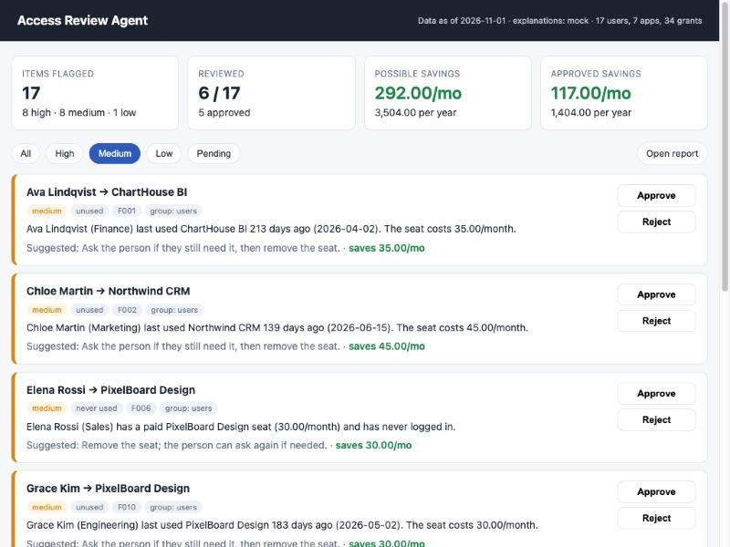
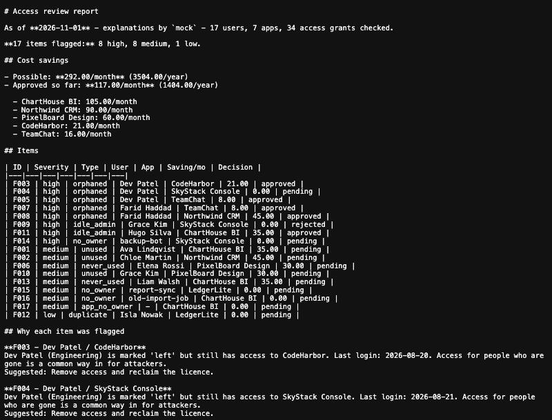
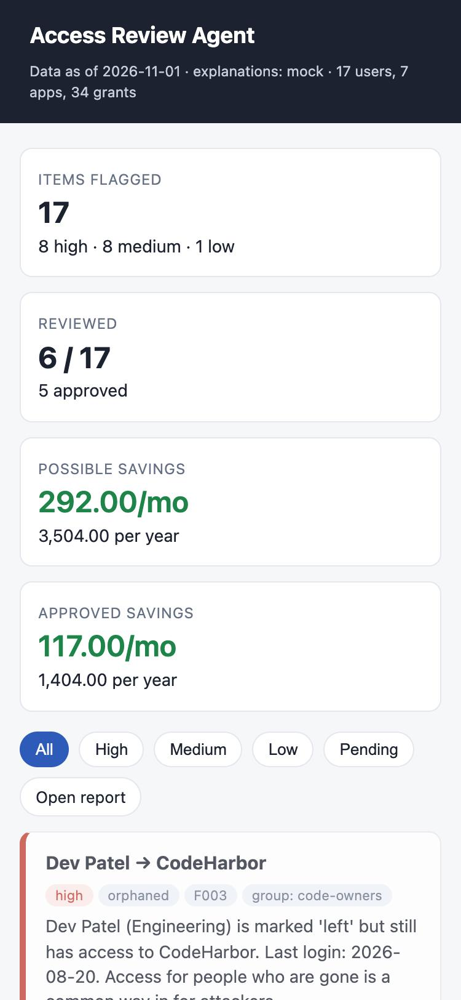

# Agentic Access Review

An AI agent that reviews who has access to what, flags access that is **unused, risky or orphaned**, explains each flag in plain English, and works out how much money unused licences cost. A person then approves or rejects each item in a small web page.

**The agent never changes anything.** It reads data and writes a report. Approved items become a to-do list for someone with the right permissions.



## Run it (one command)

Needs Python 3.9 or newer. No packages to install, no API key needed.

```bash
python3 -m access_review
```

Open http://127.0.0.1:8000, approve or reject items, then click **Open report**.

Other ways to run:

```bash
python3 -m access_review report          # just write out/report.md, no web page
ANTHROPIC_API_KEY=... python3 -m access_review --llm claude   # real Claude explanations
python3 -m unittest -v                   # run the tests
```

`--llm claude` sends each finding's facts to the Claude API and asks for a short explanation. Set `ANTHROPIC_MODEL` to pick a model (default `claude-sonnet-5-5`). If a call fails, that item falls back to the built-in explanation so the review is never blocked.

## What it checks

| Flag | Meaning | Severity |
|---|---|---|
| `orphaned` | The person has left or is disabled but still has access | high |
| `idle_admin` | Admin rights not used for 30+ days | high |
| `no_owner` | A service account (a non-human login used by a script) with no active owner | high if admin, else medium |
| `never_used` | A paid seat that has never been logged into | medium |
| `unused` | No login for 90+ days | medium (low if free) |
| `app_no_owner` | An app nobody is responsible for | medium |
| `duplicate` | Same person in two groups on one app | low |

Savings = the monthly seat cost of every flagged seat that could be removed, shown per month, per year, and for approved items only.

## How it works



Why split it like this:

- **Rules decide, the LLM explains.** Whether something is flagged is a fixed, testable rule. The language model (LLM) only turns the facts into readable sentences, so it cannot invent a flag or hide one.
- **Read-only by design.** The only files written are `out/decisions.json` and `out/report.md`. A test checks the input data is unchanged after decisions are made.
- **Human in the loop.** Every item waits for a person to approve or reject it.
- **Mock mode first.** The default explainer needs no key and gives the same output every run, so the demo and tests are repeatable.

## Project layout

```
access_review/
  rules.py      # the checks that create findings
  llm.py        # MockExplainer and ClaudeExplainer
  agent.py      # runs the review, savings summary, markdown report
  server.py     # tiny web server (standard library only)
  static/index.html
data/           # made-up demo data: users.csv, apps.csv, access.csv
tests/          # unit tests, including the web API
```

## Folder guides

Each folder has its own README:

- [access_review/](access_review/README.md) - the agent code and the seven rules
- [access_review/static/](access_review/static/README.md) - the web page
- [data/](data/README.md) - the made-up demo data and how to use your own
- [tests/](tests/README.md) - what the tests cover
- [docs/](docs/README.md) - the screenshots
- [.github/](.github/README.md) - the CI workflow

## Screenshots

Decisions update the savings totals as you go:



Filter by severity or show only pending items:



The written report, with each decision recorded:



Works on a phone:



## Using your own data

Replace the three CSV files in `data/` (keep the same column names) or pass `--data path/to/folder`. The demo pins "today" to 2026-11-01 so results stay the same; change it in `agent.run_review`.

## Notes

All names, apps and numbers in `data/` are made up.

## License

MIT - see [LICENSE](LICENSE).
