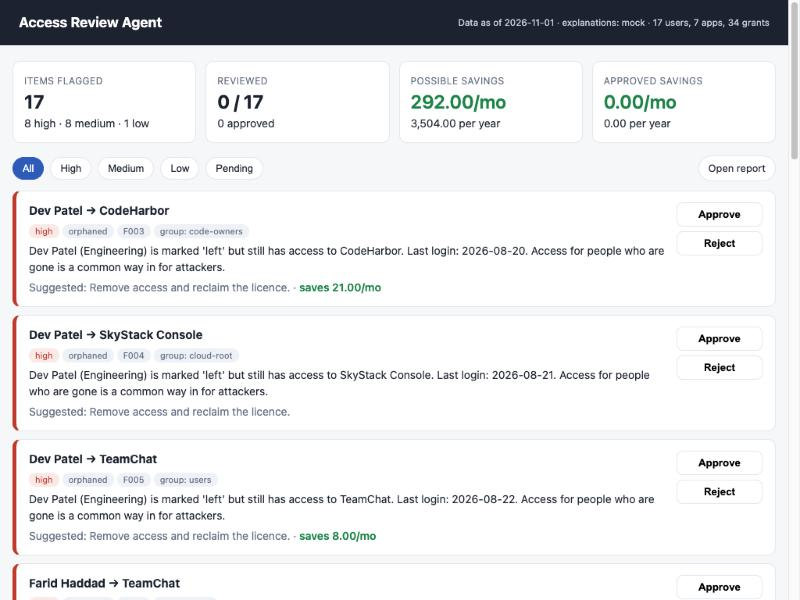

# access_review/ - the agent

The Python package that does the whole review. Standard library only.

| File | What it does |
|---|---|
| `__main__.py` | Command line. `python3 -m access_review` starts the web page; `report` just writes `out/report.md`; `--llm claude` uses the Claude API. |
| `rules.py` | Loads the CSV files and runs the checks that create findings. This is where flagging is decided. |
| `llm.py` | Writes a plain-English reason for each finding. `MockExplainer` (no key, same text every time) or `ClaudeExplainer` (uses `ANTHROPIC_API_KEY`, falls back to mock on any error). |
| `agent.py` | Runs rules + explainer, sorts by severity, works out savings and writes the markdown report. |
| `server.py` | Tiny web server for the approval page. Saves decisions to `out/decisions.json`; changes nothing else. |
| `static/` | The one-page web UI. See [static/README.md](static/README.md). |

Flow: `rules.py` -> `llm.py` -> `agent.py` -> `server.py` / report.

## The seven flag rules

| Flag | Meaning | Severity |
|---|---|---|
| `orphaned` | Person has left or is disabled but still has access | high |
| `idle_admin` | Admin rights not used for 30+ days | high |
| `no_owner` | Service account (a login used by a script) with no active owner | high if admin, else medium |
| `never_used` | Paid seat never logged into | medium |
| `unused` | No login for 90+ days | medium (low if free) |
| `app_no_owner` | App with nobody responsible for it | medium |
| `duplicate` | Same person in two groups on one app | low |

The rules decide; the language model only explains. It cannot add, hide or act on a flag.

