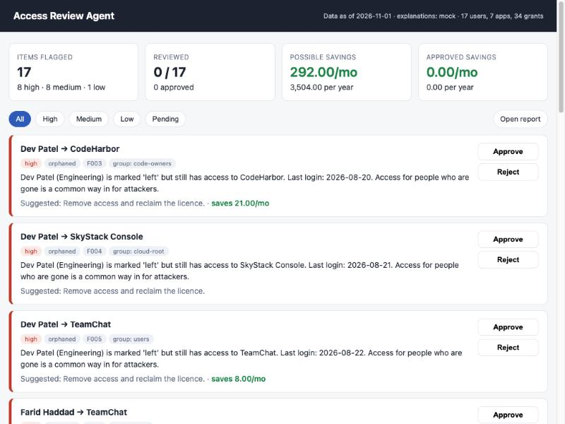
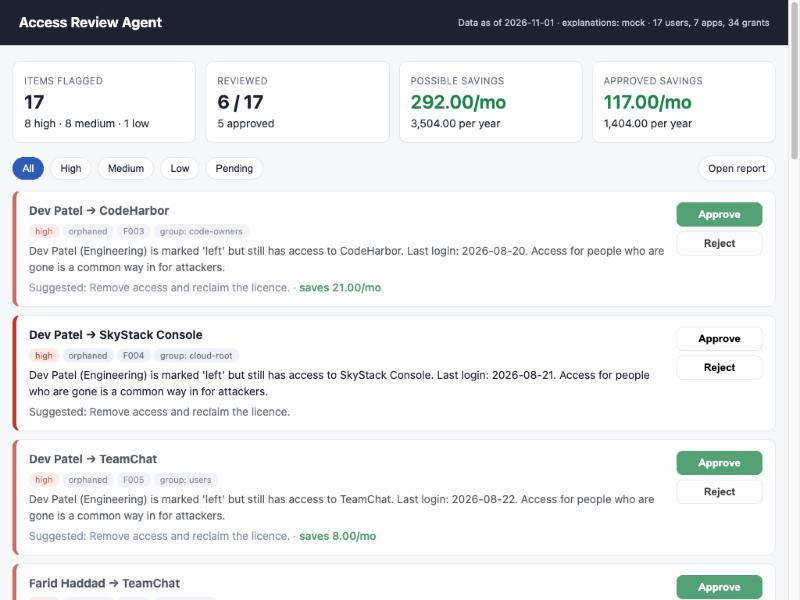
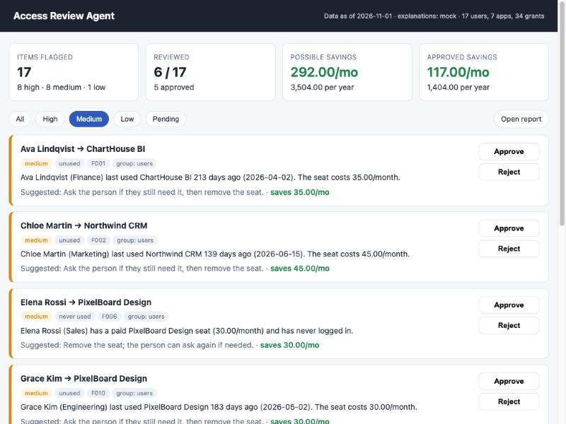
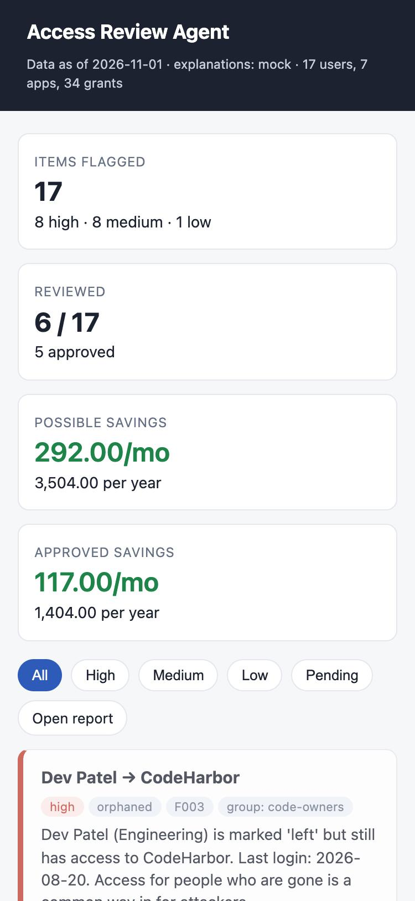

# access_review/static/ - the web page

`index.html` is the whole approval UI: HTML, CSS and a little JavaScript, no build step and no libraries. `server.py` serves it at `/`.

It reads findings from `GET /api/review`, sends each Approve/Reject click to `POST /api/decision`, and links to `/report.md`. Clicking the same button again sets the item back to pending. Tiles at the top show counts and possible vs approved savings; the pills filter by severity or pending.

