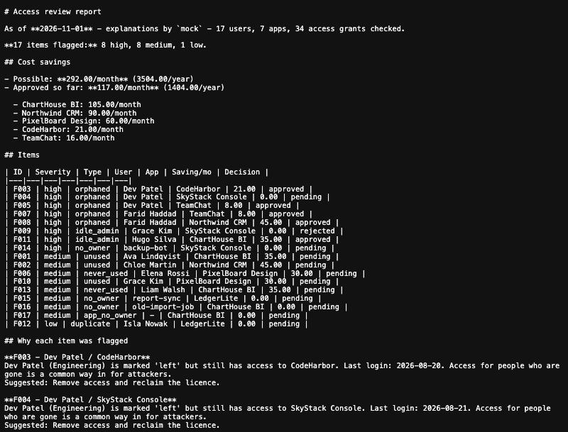

# docs/

`screenshots/` holds images of the running app with demo data, used in the READMEs:

| File | Shows |
|---|---|
| `01-review-queue.jpg` | Start page: totals and the flagged items, high severity first |
| `02-decisions-and-savings.jpg` | After some approve/reject clicks; approved savings updated |
| `03-medium-filter.jpg` | Filtered to medium items |
| `04-report.jpg` | The generated `report.md` with decisions |
| `05-mobile.jpg` | Phone-width layout |

